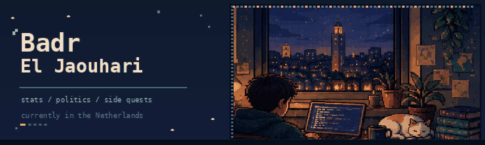

<!-- GitHub profile README for BadrELJAOUHARI/BadrELJAOUHARI -->

  

  Usually somewhere between statistics, politics, and another side project.

  

    <a href="https://www.linkedin.com/in/badr-el-jaouhari-94b517246/">LinkedIn</a> &nbsp;·&nbsp;
    <a href="https://substack.com/@badreljaouhari">Substack</a> &nbsp;·&nbsp;
    <a href="https://github.com/BadrELJAOUHARI?tab=repositories">Repositories</a>
  

### 01 / hello

Hey, I'm Badr. I studied international relations and slowly got pulled into statistics. I liked working with political data during my bachelor's, and I wanted to understand the methods properly. I haven't really left politics behind. I just spend a lot more time in R now.

I'm originally from Morocco and currently based in Voorburg, near The Hague. I'm finishing an **MSc in Methodology, Statistics and Data Science at Utrecht University**, following the **European Master in Official Statistics (EMOS)** track. Most of my work lately involves missing data, statistical modelling, and finding out what happens when a method looks good on paper but less good in a simulation.

Outside of that, I like maps, history, philosophy, writing, and the occasional game-design rabbit hole.

### 02 / on my desk lately

- **Master's thesis at Statistics Netherlands (CBS):** looking at machine-learning approaches to automatic editing of business survey data. I'm part of the Methodology Department in The Hague.
- **Research at Utrecht University:** recently worked on multilevel missing-data methods, including a custom `mice` imputation function using `glmmTMB` and a simulation study of how it performs.
- **Next, starting November 2026:** a research student-assistant role at Utrecht University, looking at mixed-language speech recognition in LENA recordings using Whisper and BabyHuBERT.
- **After hours:** working on small data projects and writing about technology, politics, and whatever has been on my mind lately on [Substack](https://substack.com/@badreljaouhari).

### 03 / places I've learned things

| When | Where | What I did |
| :-- | :-- | :-- |
| **2025 to 2027** | **Utrecht University** | MSc in Methodology, Statistics and Data Science. EMOS track. Graduate Honours Interdisciplinary Seminars alumnus and Honours Council member. |
| **2022 to 2025** | **Mohammed VI Polytechnic University** | BA in International Relations, with a minor in Data Analytics for Politics. |
| **2025** | **Sciences Po Lyon** | Diploma of Political Studies. |

A few workplaces have also shaped how I think about data:

- **Statistics Netherlands (CBS), 2026 to present.** Graduation intern in the Methodology Department, working on the use of machine learning in survey editing.
- **Utrecht University, February to October 2026.** Research trainee with the Missing Data Group. Wrote R code and ran simulations comparing multilevel imputation methods.
- **Joint Impact Model Foundation / FMO, March to September 2026.** Worked on impact analysis for partner banks in emerging markets, model testing, and the less glamorous but essential job of getting data and processes to behave.
- **UCESA, 2024.** Worked on international partnerships, including the onboarding of five member states, and research into climate mobility in Africa.
- **SNRT, 2023.** Helped review international partnership agreements and co-write the annual activity report.

### 04 / projects

A few things I've worked on. Some are full analyses; others started as experiments or course projects.

- [**Multilevel imputation with `glmmTMB` + `mice`**](https://github.com/BadrELJAOUHARI/GlmmTMB-mice)  
  An R imputation function and a simulation study comparing it with an existing multilevel approach.

- [**Bayesian FIFA ranking analysis**](https://github.com/BadrELJAOUHARI/bayesian-fifa-ranking-analysis)  
  Bayesian regression on FIFA rankings and wins, with a Gibbs sampler written in R.

- [**Missing household income in Europe**](https://github.com/BadrELJAOUHARI/ESS9-Household-Income-Multiple-Imputation)  
  A group study using European Social Survey data, looking at survey weights and multiple imputation in five countries.

- [**Five Minutes to Midnight**](https://github.com/BadrELJAOUHARI/5-Minutes-to-Midnight)  
  A Cold War strategy board-game design about influence, brinkmanship, and nuclear risk. A tabletop prototype, not a video game.

- [**HousingyBot**](https://github.com/BadrELJAOUHARI/housingybot)  
  A Python template for monitoring permitted public listings and sending notifications.

- [**Child stunting in Marrakech-Tensift-El Haouz**](https://github.com/BadrELJAOUHARI/Regional-Analysis-of-Child-Stunting-in-Marrakech-Tensift-El-Haouz-DHS-2003-2004)  
  DHS data, Stata, logistic regression, and socioeconomic indicators.

- [**Predicting cat weight**](https://github.com/BadrELJAOUHARI/Predicting-Cat-Weight-and-Health-Indicators-from-Veterinary-Records-in-R)  
  Random forests versus linear regression on veterinary records. Yes, it's actually about cats.

A few other experiments live in [my repositories](https://github.com/BadrELJAOUHARI?tab=repositories).

### 05 / the toolbox

| | |
| :-- | :-- |
| **Most-used languages** | R, Python, SQL |
| **Statistical software** | Stata, **Mplus**, **JAGS** |
| **R and reproducibility** | Quarto, `mice`, `glmmTMB`, `ggplot2`, `tidyverse` |
| **Python and ML** | pandas, NumPy, NLTK, scikit-learn, random forests |
| **Methods I work with** | Bayesian inference, multilevel models, multiple imputation, Monte Carlo simulations, survey data analysis |
| **Other things I've tried** | C++, JavaScript, CSS, Blender, Adobe Creative Cloud |

I like learning tools when a project actually gives me a reason to use them. The list changes pretty often.

### 06 / some highlights along the way

- **Utrecht Excellence Scholarship**, a fully funded two-year merit scholarship for my master's.
- **Winner of the first Nudgeathon Hackathon Morocco** in 2023, with a team idea on reducing water waste in traditional hammams.
- **National finalist in the Olympiads of Informatics** in Morocco.
- **Best Project Award at Design My Future Morocco 2056** in 2019.
- Selected for the **US Embassy in Morocco's Leadership Lab**, among 60 fellows from over 1,200 applicants.
- Founded **Artscape UM6P**, a student club for arts and culture. Also helped organize the **Local Conference of Youth Morocco 2025** and worked on the youth statement for COP30.

### 07 / when I'm not in RStudio

Usually reading something about politics or philosophy, trying to write, learning a language, playing tennis, swimming, or messing with a design idea in Blender. Arabic is my first language; I also speak English and French, and I'm learning Dutch and German. I also enjoy bringing people from different fields together. The Artscape club and the youth-policy work are probably the best examples of that.

I write on [Substack](https://substack.com/@badreljaouhari) when I have an idea I want to explore beyond a figure or a regression table.

  
<strong>One more thing: the tiny arcade</strong>

   
  
My contribution grid, but with a pixel snake. It will appear once the included GitHub Action runs.

  

    <picture>
      <source media="(prefers-color-scheme: dark)" srcset="https://raw.githubusercontent.com/BadrELJAOUHARI/BadrELJAOUHARI/output/github-snake-dark.svg" />
      <source media="(prefers-color-scheme: light)" srcset="https://raw.githubusercontent.com/BadrELJAOUHARI/BadrELJAOUHARI/output/github-snake.svg" />
      
    </picture>
  

---

  Thanks for stopping by. Feel free to say hi.
  
<a href="https://www.linkedin.com/in/badr-el-jaouhari-94b517246/">Say hello on LinkedIn</a>

